<p align="center">
  
</p>

<p align="center">
  <a href="https://github.com/olozano-p/sota-lms/actions/workflows/ci.yml"></a>
  <a href="https://github.com/olozano-p/sota-lms/actions/workflows/codeql.yml"></a>
  
  
  
  
  
</p>

<p align="center">
  <a href="#what-it-does">Features</a> ·
  <a href="#who-sees-what">Access</a> ·
  <a href="#make-it-yours">Theming</a> ·
  <a href="#deploy">Deploy</a> ·
  <a href="#stack">Stack</a> ·
  <a href="#by-the-numbers">Numbers</a> ·
  <a href="#develop">Develop</a>
</p>

**SOTA** is an open-source platform for teaching online that you run yourself. Courses are made of
chapters, chapters of lessons, lessons of blocks: rich text, video, audio, files, embeds, assignments
and quizzes. Learners join cohorts with drip release, pick up where they left off, and talk in a forum.

It delivers lessons and nothing else: **it never sells anything**. Who someone is comes from your
identity provider, or from SOTA's own accounts for a small school. What they may open comes from an
enrollment source you control: your shop, a spreadsheet of names, an API call.

<p align="center">
  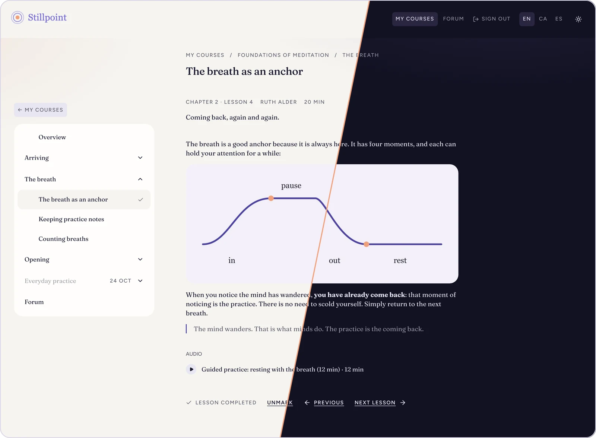
</p>

<p align="center"><sub>Every screenshot shows <b>Stillpoint</b>, a made-up meditation school, using
<a href="examples/themes/twilight"><code>examples/themes/twilight</code></a>: one <code>theme.json</code>,
three font files and twenty lines of CSS. No <code>.ts</code> file was touched.</sub></p>

<p align="center"></p>

## What it does

### For learners

<table>
  <tr>
    <td width="50%" valign="top">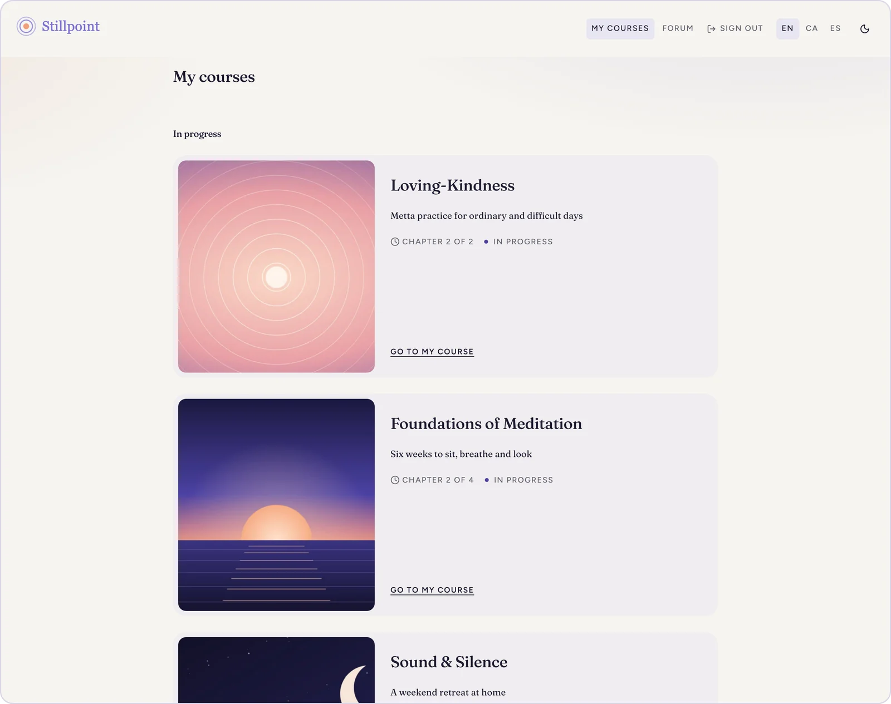<br><b>My courses</b>: in progress, finished, and locked with the reason and the date it opens.</td>
    <td width="50%" valign="top">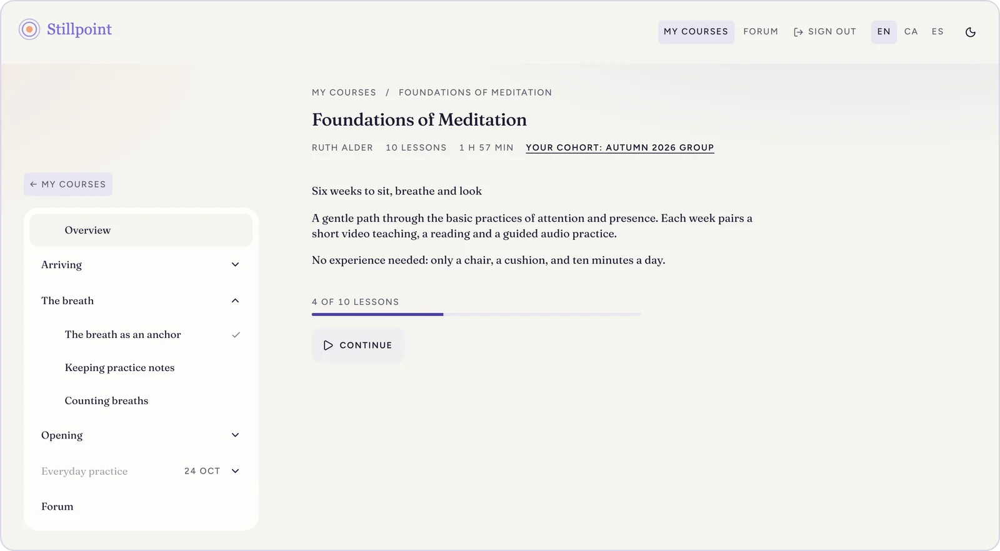<br><b>The course</b>: a syllabus rail with lesson states, the cohort, one progress rule and one <i>Continue</i> button.</td>
  </tr>
  <tr>
    <td width="50%" valign="top">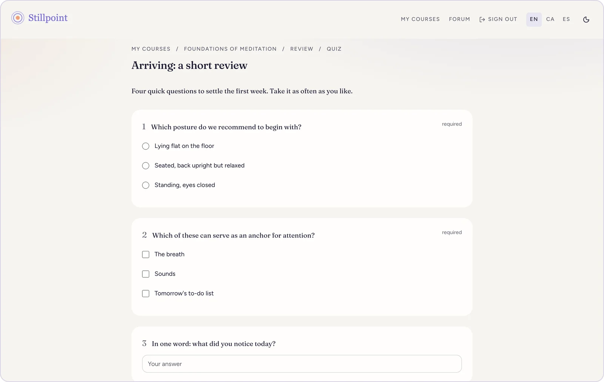<br><b>Quizzes and forms</b>: four question types, self-check feedback, retakes.</td>
    <td width="50%" valign="top">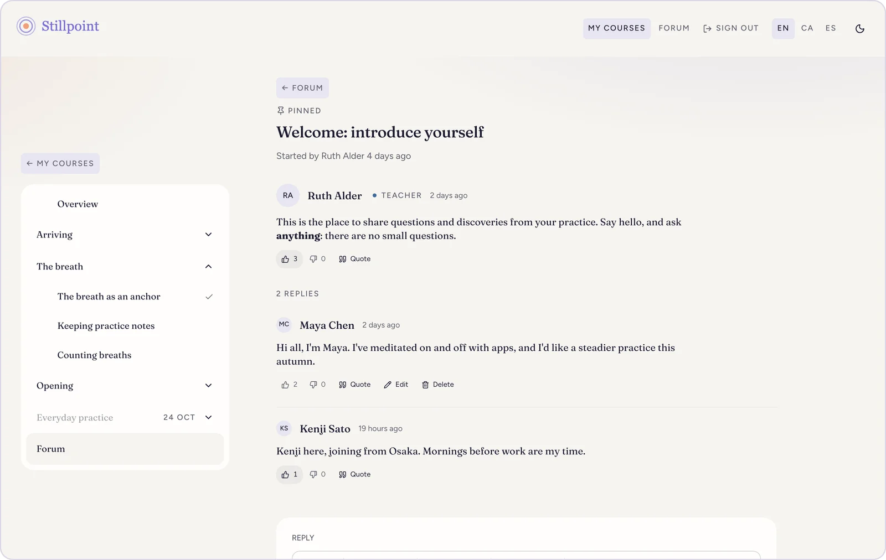<br><b>Forums</b>: one per course and a general one, pinned threads, quoting, likes, moderation by the course's teachers.</td>
  </tr>
</table>

Progress is kept per lesson and media resume where they stopped. Keyboard navigation in the player,
dark mode, and three languages shipped (English, Catalan, Spanish), switchable from every page.

### For teachers

<table>
  <tr>
    <td width="50%" valign="top">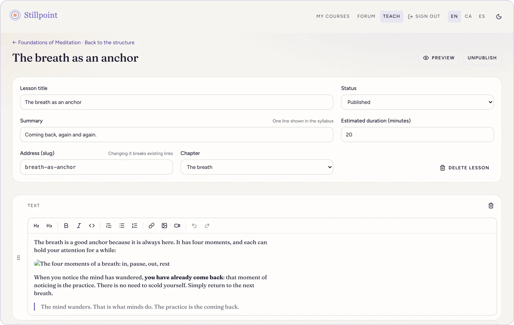<br><b>The editor</b>: drag to sort, autosave, rich text edited in place and stored as Markdown, streamed uploads.</td>
    <td width="50%" valign="top">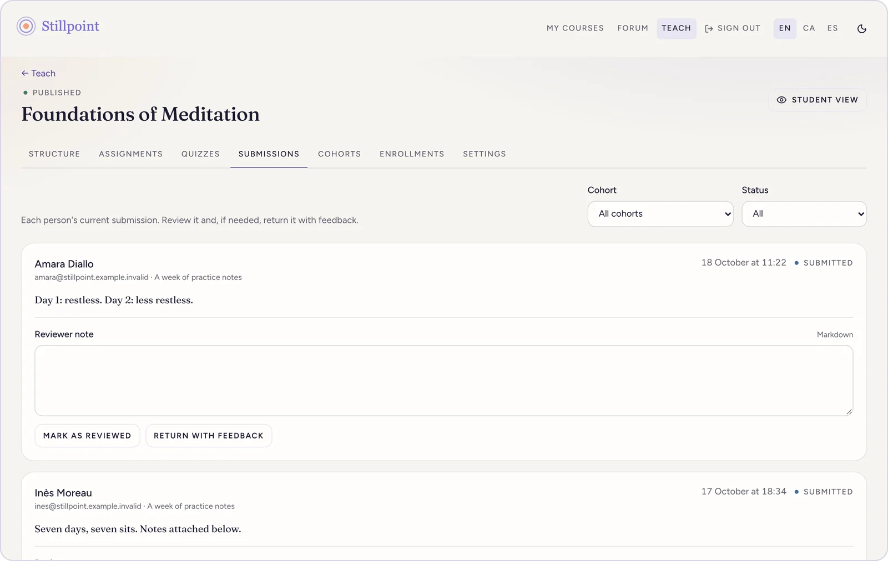<br><b>Assignments</b>: text and/or file, resubmission, review with feedback, filtered by cohort and status.</td>
  </tr>
  <tr>
    <td width="50%" valign="top">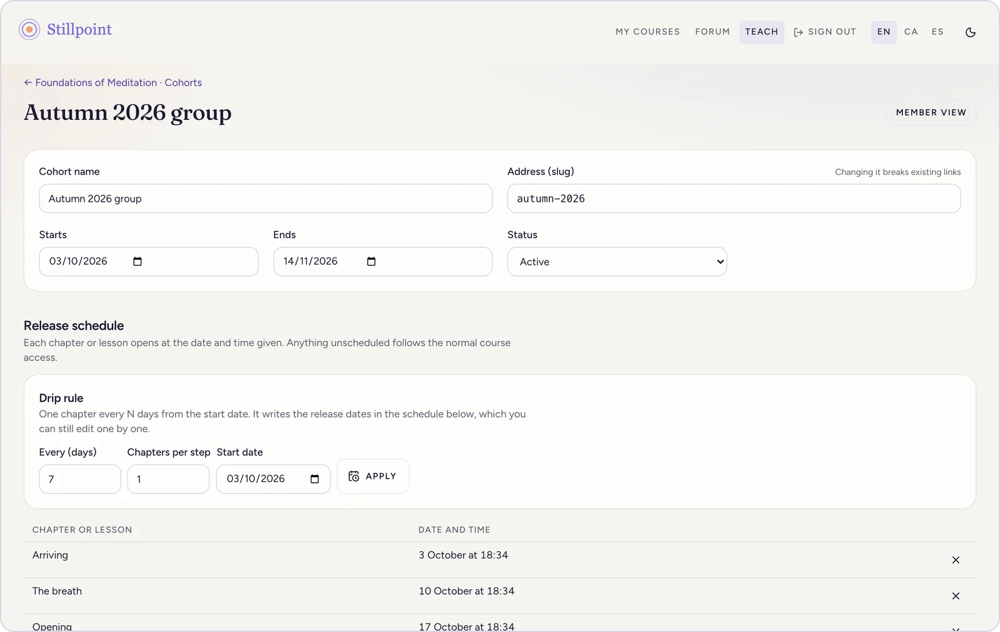<br><b>Cohorts</b>: drip release by chapter or lesson, or “one chapter every 7 days”, each date still editable.</td>
    <td width="50%" valign="top">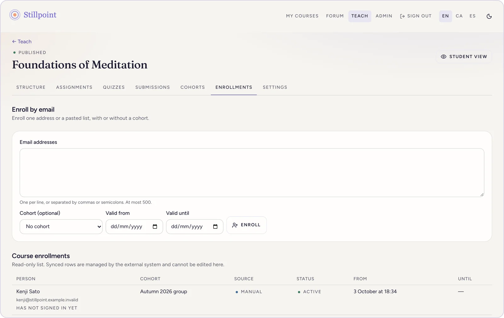<br><b>Enrollments</b>: by email or a pasted list, with or without a cohort; every row shows where it came from.</td>
  </tr>
</table>

### For whoever runs it

An admin area for people, invitations, the webhook log and the audit log. Mail is queued and sent by
a tick, with feedback at once and the rest in a daily digest. `pnpm sota export` / `import` copy
courses with their media between instances, idempotently, and `pnpm sota import-progress` brings
learners' completions over from another LMS.

<p align="center"></p>

## Who sees what

<p align="center">
  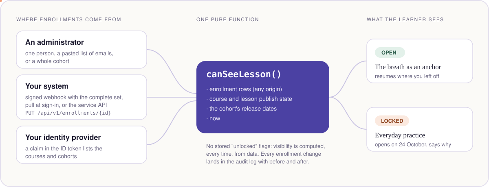
</p>

**Who signs in** is one variable, `AUTH_MODE`:

- **`local`** (default): email and password, magic links, administrator invitations, optional
  self-registration. SOTA keeps the accounts and needs nothing but Postgres.
- **`oidc`**: sign-in is delegated to your identity provider (Keycloak, Authentik, Entra, Google…).
  SOTA mirrors the person, takes roles from a claim and, if you like, enrollments from another one.
  No local password exists apart from an optional break-glass administrator.

**What they may open** is an enrollment row, whatever wrote it: an administrator, a signed webhook
carrying the complete set, a pull at sign-in, the service API (`PUT`/`DELETE
/api/v1/enrollments/{id}`, OpenAPI at `/api/v1/openapi.json`) or an ID-token claim. Rows from a sync
never touch the ones an administrator made. Details: [`docs/idp-integration.md`](docs/idp-integration.md),
[`docs/integration.md`](docs/integration.md), [`docs/entitlements-contract.md`](docs/entitlements-contract.md),
[`docs/audit-log.md`](docs/audit-log.md).

<p align="center"></p>

## Make it yours

<p align="center">
  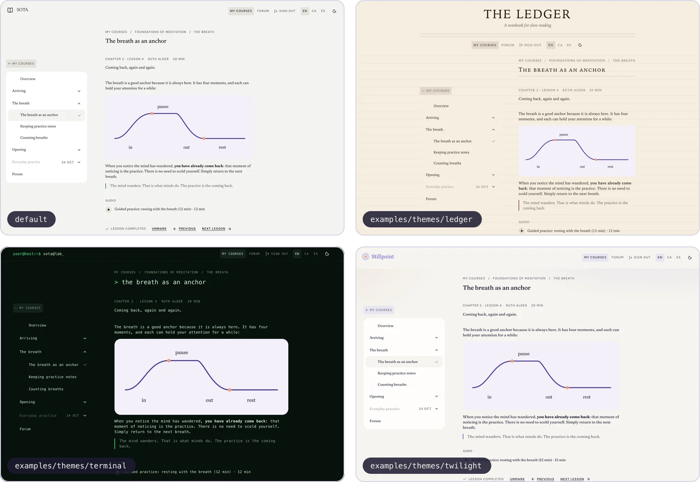
</p>

Same course, same build of the code, four theme directories. A theme is a folder (`THEME_DIR`)
layered over the defaults:

```text
theme/
  theme.json        name, tagline, logo, colours (light and dark), fonts, radii, spacing, language
  custom.css        appended last
  messages/en.json  reworded copy, per language
  emails/           mail layouts
  assets/           logo, favicon, self-hosted fonts
  slots/Header.tsx  replace one of seven named parts of the UI (compiled in)
```

Everything but the slots is read at runtime: mount the folder and restart. Colours become CSS
variables, so components never hold a hex value and dark mode keeps working. Check yours with
`pnpm sota validate-theme`; the full reference is [`docs/theming.md`](docs/theming.md).

<p align="center">
  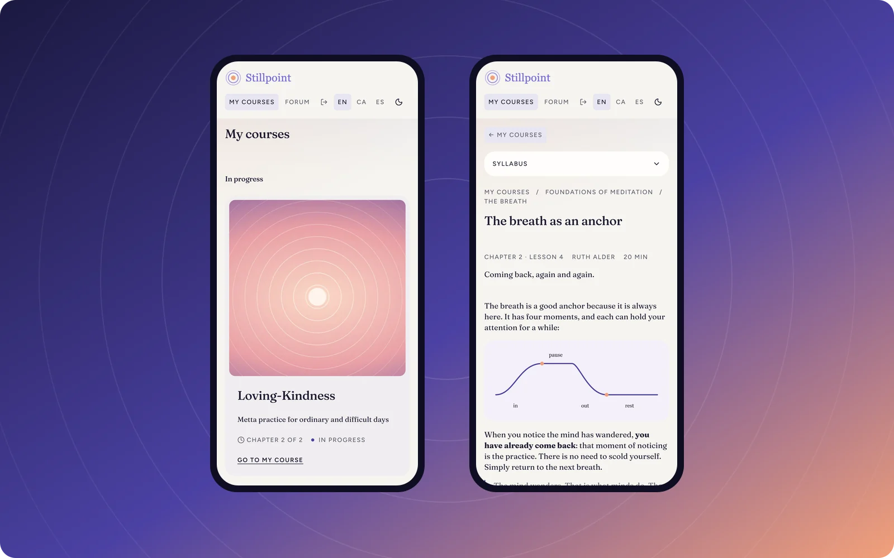
</p>

<p align="center"></p>

## Deploy

<p align="center">
  
</p>

**You need** one machine with Docker. No identity provider, mail server or cloud account to start.

```bash
mkdir sota && cd sota
curl -fsSLO https://raw.githubusercontent.com/<owner>/sota/main/compose.yml   # or copy it from a checkout
cat > .env <<EOF
APP_URL=http://localhost:3003
SESSION_SECRET=$(openssl rand -base64 32)
POSTGRES_PASSWORD=$(openssl rand -hex 16)
SOTA_IMAGE=ghcr.io/<owner>/sota:1.1.0
EOF
docker compose up -d
docker compose exec app node scripts/sota.ts create-admin --email you@example.org --name "You"
```

Open http://localhost:3003 and sign in. Migrations run on every start: to upgrade, take a backup,
change the tag in `SOTA_IMAGE`, then `docker compose pull && docker compose up -d`.

| Topic                    | Details                                                                                                   |
| ------------------------ | --------------------------------------------------------------------------------------------------------- |
| **What runs**            | two containers: `app` (Node 24 Alpine) and `postgres:16-alpine`; files on a named volume                  |
| **Images**               | every version tag at `ghcr.io/<owner>/sota`; or `docker build -t sota:local .`                            |
| **Going public**         | put it behind a reverse proxy with TLS, set `APP_URL`, add SMTP: [`docs/deploying.md`](docs/deploying.md) |
| **Every variable**       | [`docs/configuration.md`](docs/configuration.md), checked at boot (`pnpm sota validate-config`)           |
| **Backups and upgrades** | [`docs/backup-restore.md`](docs/backup-restore.md) · [`docs/deploy.md`](docs/deploy.md)                   |
| **Watching it**          | JSON logs on stdout, `/api/health`: [`docs/observability.md`](docs/observability.md)                      |

`docs/deploying.md` walks from here to a published course and a learner who has finished it.

<p align="center"></p>

## Stack

<p align="center">
  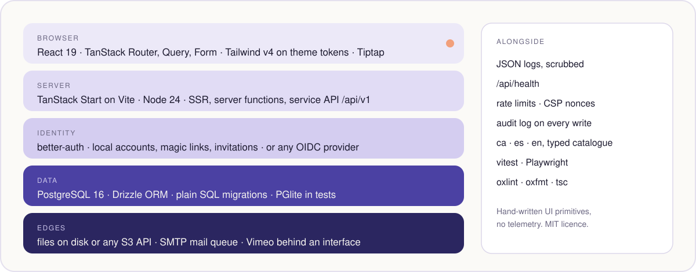
</p>

| Layer        | Choice                                                                                     |
| ------------ | ------------------------------------------------------------------------------------------ |
| **App**      | TanStack Start (React 19, Router, Query, Form) on Vite, server-rendered, one Node server   |
| **Data**     | PostgreSQL 16 with Drizzle; generated SQL migrations; PGlite in memory for tests           |
| **Identity** | better-auth: local accounts, magic links and invitations, or a generic OIDC client         |
| **Files**    | local disk (default) or any S3 API, behind one interface; private, signed, resized to WebP |
| **UI**       | Tailwind v4 mapped to theme tokens, hand-written primitives, Tiptap for rich text          |
| **Quality**  | TypeScript, vitest, Playwright, oxlint and oxfmt; a pre-commit hook runs the gates         |

Why each piece was chosen is written down in [`docs/decisions/`](docs/decisions).

<p align="center"></p>

## By the numbers

<p align="center">
  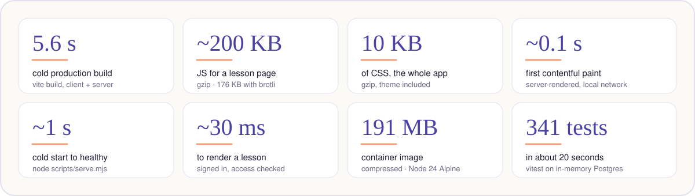
</p>

<details>
<summary><b>How these were measured</b></summary>

SOTA 1.1.0 on an Apple M1 Pro (10 cores), Node 24, Postgres 16 in Docker, with the demo data in the
screenshots. Numbers on your hardware will differ; the method is what matters.

| Number          | How                                                                                                                              |
| --------------- | -------------------------------------------------------------------------------------------------------------------------------- |
| Build           | `pnpm build` with `dist/` and the Vite cache removed: 5.6 s wall clock for the client and the server bundles                     |
| JavaScript, CSS | every file a fresh browser loads for a signed-in lesson page, compressed: 203 KB JS gzip (176 KB brotli) in 19 chunks, 10 KB CSS |
| Whole client    | 94 chunks, 427 KB gzip in total; each route's code loads when it is first visited                                                |
| First paint     | Chromium via Playwright against the production server on the same machine: 70 to 170 ms first contentful paint once warm         |
| Cold start      | `node scripts/serve.mjs` to the first `200` from `/api/health`: 1.06 s; about 270 MB resident at rest                            |
| Lesson render   | 300 sequential signed-in requests for a lesson page (session, access check, SSR): 25 to 35 ms each                               |
| Image           | `docker build .`: 652 MB unpacked, 191 MB as `docker save \| gzip`                                                               |
| Tests           | `pnpm test`: 341 tests in 44 files in about 20 s, against an in-memory PGlite                                                    |

</details>

<p align="center"></p>

## Develop

```bash
git clone <repository-url> sota && cd sota
cp .env.example .env
pnpm install                                                # installs the git hooks too
docker compose -f compose.dev.yml up -d postgres mock-idp   # services only
pnpm db:migrate && pnpm db:seed
pnpm dev                                                    # http://localhost:3003
```

Sign in through the mock identity provider on port 3013 (student, delayed-access student, teacher,
admin), or run the whole stack with `docker compose -f compose.dev.yml up`. Try a theme with
`THEME_DIR=examples/themes/twilight pnpm dev`.

| Command                                                   | What                                                                                                          |
| --------------------------------------------------------- | ------------------------------------------------------------------------------------------------------------- |
| `pnpm dev` / `pnpm build` / `pnpm start`                  | dev server · production build · serve `dist/`                                                                 |
| `pnpm typecheck` · `pnpm lint` · `pnpm fmt` · `pnpm test` | the gates the pre-commit hook mirrors                                                                         |
| `pnpm e2e`                                                | Playwright suites against the compose stack                                                                   |
| `pnpm db:generate` / `pnpm db:migrate` / `pnpm db:seed`   | new migration from the schema · apply · demo data                                                             |
| `pnpm sota <command>`                                     | `migrate`, `seed`, `create-admin`, `validate-config`, `validate-theme`, `export`, `import`, `import-progress` |
| `pnpm notify`                                             | one notification tick (mail and digest)                                                                       |
| `pnpm mock-idp`                                           | run the development IdP + enrollment source alone                                                             |

Releases: bump `package.json` and `CHANGELOG.md` on main, tag `vX.Y.Z` and push the tag;
`.github/workflows/release.yml` runs CI and publishes the image.

| Read                                | For                                                |
| ----------------------------------- | -------------------------------------------------- |
| [`docs/spec.md`](docs/spec.md)      | what SOTA is meant to do                           |
| [`docs/decisions/`](docs/decisions) | why it is built this way (ADRs)                    |
| [`docs/DESIGN.md`](docs/DESIGN.md)  | visual rules                                       |
| [`CLAUDE.md`](CLAUDE.md)            | the invariants, for people and coding agents alike |
| [`CHANGELOG.md`](CHANGELOG.md)      | what changed in each version                       |

## The name

The Pali [_sotāpanna_](https://en.wikipedia.org/wiki/Sot%C4%81panna) is "the one who has entered the
stream": the moment a path stops being an idea and becomes the direction you are already moving in.
SOTA wants to be that first step for the people who learn with it, and to get out of the way once
they are moving.

## Contributing and licence

See [`CONTRIBUTING.md`](CONTRIBUTING.md); security reports go to [`SECURITY.md`](SECURITY.md).
SOTA is released under the [MIT licence](LICENSE) (ADR-006).
